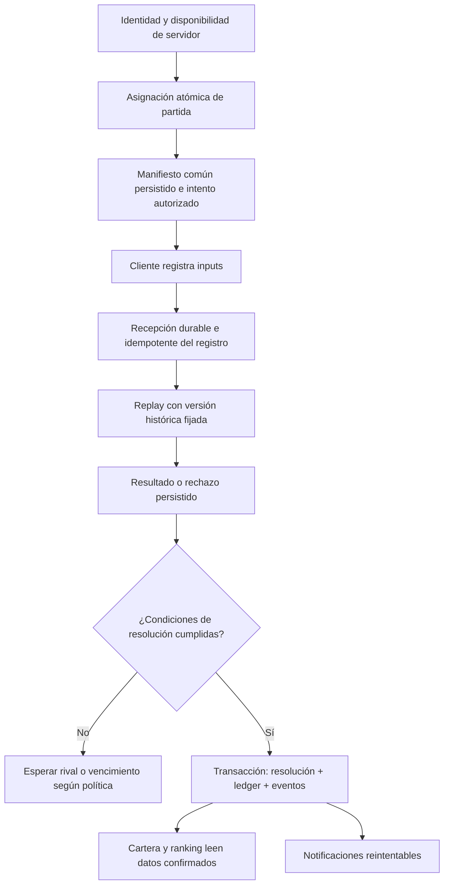

# Revisión de arquitectura para producción

Fecha: 15 de octubre de 2026. Base revisada: `v97-mobile`,
`f986b28a5d9aa85e7409e2d04d1f20deaa2a23de`, coincidente con `mobile-test`
en la consulta remota. Es una auditoría y propuesta incremental, no una
activación de producción ni un ADR que cambie los contratos publicados.

## Dictamen

La arquitectura de simulación es una base válida y debe conservarse. La
plataforma completa **todavía no está preparada para usuarios y carteras reales**.
Actualmente se puede verificar un replay sin guardar su registro, consumir el
intento, recuperar un oponente real ni liquidar una cartera en servidor.
Configurar PostgreSQL o una clave de firma no conecta automáticamente esas piezas.

No recomiendo una reescritura ni microservicios por juego. Recomiendo completar
un backend modular sobre los límites existentes y retirar gradualmente las
decisiones económicas de la UI. Un worker de verificación/notificaciones puede
añadirse al mismo dominio si la carga y los tiempos medidos lo requieren.

## Qué conservar

- Registry y carga lazy: `lib/games.ts`, `components/GameLoader.tsx`.
- Cores puros/versionados, inputs por ticks, validadores, serialización y
  hashes; archivo de adapters en `lib/server/gameVerifiers.ts:463`.
- Lifecycle y registro compartidos en `lib/verified/useVerifiedAttempt.ts` y
  runtime común. Single-flight y transporte desacoplado del desmontaje ya existen.
- Contratos V2/V3 y generadores compartidos de `lib/server/scenarios.ts`.
  Compatibilidad de V2 y hashes históricos no se deben modificar.
- PostgreSQL mediante interfaces: manifiestos inmutables con pertenencia,
  comandos privados con CAS, pool común y ranking de lectura separado.
- Autoridad privada de Mine: el servidor conserva el secreto y proyecta sólo
  lo visible. Reutiliza `replayCore`; no es otro motor competitivo.
- Separación de muestras y ranking real; fallo cerrado al faltar configuración.

## Hallazgos por prioridad

P0 significa bloqueo de activación de competición/cartera real; no implica que
haya dinero real expuesto actualmente. P1 debe resolverse antes del lanzamiento
público competitivo. P2 es mantenibilidad/operación y se aborda por unidades.

| ID | Prioridad | Evidencia del código revisado | Consecuencia y tratamiento |
| --- | --- | --- | --- |
| A1 | P0 | `app/api/verified-match/verify/route.ts:40` llama a `processAttemptRecord`; `lib/server/verifiedMatch.ts:414` hace replay y `:453` devuelve un UUID nuevo sin repositorio | Verificado no significa almacenado ni consumido. Guardar registro, resultado y estado del intento; unicidad/idempotencia en PostgreSQL antes de liquidar. |
| A2 | P0 | `components/DemoApp.tsx:726` descuenta saldo; `:782` decide el ganador; `:858`/`:881` abona premios; `:426` persiste saldo en localStorage | Economía ficticia controlada por navegador. La cartera real debe ser una lectura del ledger; reserva y liquidación autorizadas únicamente por servidor. Un `verified: true` de un callback no es prueba económica. |
| A3 | P0 | `app/api/verified-match/start/route.ts:59` crea un manifiesto independiente y `:65` un jugador aleatorio en A; `lib/server/verifiedMatch.ts:63` usa una clave pública de entrenamiento si falta configuración | No hay identidad autenticada ni pertenencia de sesión en la ruta pública. La firma acredita un ticket, no una sesión ni fondos. El acceso competitivo debe fallar cerrado si faltan identidad, persistencia, claves o políticas. Añadir sólo la clave no basta. |
| A4 | P0 | `lib/games.ts:573` alterna modos según `nextTurn` local y `waitingStakes`; el inicio público emite V2; `selectScenario` existe en `lib/server/scenarios.ts:104` pero no participa en ese inicio | No existe inventario real de jugadas ni asignación atómica del segundo participante al mismo escenario. Integrar disponibilidad y matchmaking con un manifiesto persistido común. Una seed nueva por petición no empareja jugadores. |
| A5 | P1 | `useVerifiedAttempt.ts:111` envía fetch; keepalive sólo hasta60KB; `submissionGate.ts` conserva la promesa incluso tras fallo; no hay bandeja persistente/reconsulta | La protección contra doble envío UI funciona, pero red caída/cierre duro pueden perder el registro. Añadir recepción durable, reintento idempotente y recuperación del estado. Nunca liquidar por ausencia de respuesta o confiar en que el navegador siempre entregará. |
| A6 | P1 | Sólo existen rutas de inicio/verificación, Mine privado y ranking; no hay dominio de notificaciones, outbox, suscripciones o service worker push | No hay notificaciones reales de rival, resolución o cartera. Insertar eventos con la transacción que cambia el estado; entregarlos y reintentarlos después, con deduplicación. |
| A7 | P1 | Catálogo:23 activos,21 `server-replay`, Mine/Solitaire `client-result`; `MineGridEntry.tsx:28` conserva fallback legacy; `SolitaireSprint.tsx:137` calcula resultado local | No toda partida cumple captura/replay autoritativo. Mantener legacy sólo para entrenamiento; competición real necesita lista de capacidades autorizada en servidor. Mine privado requiere PostgreSQL configurado; Solitaire aún necesita migración propia de estado secreto. |
| A8 | P1 | `verify/route.ts:28` lee todo el cuerpo antes del límite real; inicio usa `request.json()` sin límite explícito; replay síncrono en `verifiedMatch.ts:414` precede al control temporal `:420`; sin cuotas de aplicación | Hay límites de inputs/ticks, pero no protección integral de recursos. Reutilizar lectura acotada por streaming de `hiddenHttp.ts`, añadir cuotas por actor/operación, presupuesto de replay y métricas. La protección externa de Vercel/WAF no se ha auditado. |
| A9 | P2 | `DemoApp.tsx` reúne1527 líneas de identidad, navegación, saldo, grupos y resultados; `GroupHub.tsx`1053; `globals.css`6262, con capas históricas | El mayor riesgo de parches está en la plataforma/UI, no en conservar cores históricos. Separar controladores y vistas por dominio, comenzando por economía/disponibilidad. No fragmentar cada juego ni refactorizar CSS completo sin una necesidad concreta. |
| A10 | P1/P2 | El ranking PG espera `skill_arena_global_profit_ranking`, sin productor de liquidaciones; sólo hay migraciones de manifiestos/comandos; no hay outbox/ledger/recuperación operativa | El read model está preparado, no alimentado por dinero real. Faltan ledger, proyección, reconciliación, retención y recuperación. No sustituirlos con filas de ejemplo. |

Otros límites relevantes:

- El grupo actual (`lib/groupPlay.ts:83`) crea miembros simulados; no comprueba
  membresía compartida ni organiza competición real. La distribución de premios
  de `DemoApp` no puede convertirse en el servicio de liquidación.
- El entrenamiento privado PG tiene un tope global2000 y20 por actor/24h
  (`persistedHiddenTraining.ts:36`), sin limpieza programada. Es una barrera
  provisional de entrenamiento, no una política operativa ni cuota por persona.
- Los montos locales usan `number`/`toFixed`. El ranking ya preserva céntimos
  exactos; extender esa disciplina a un ledger de unidades menores enteras,
  moneda explícita y serialización sin pérdida de precisión.
- Replay válido demuestra reglas reproducibles; no demuestra habilidad humana
  ni impide bots. Los juegos de información pública necesitan una política de
  abuso propia; los secretos de Mine/Solitaire nunca deben enviarse al cliente.
- Los tests automatizados de navegador existen como scripts, pero el workflow
  actual no los ejecuta. No equiparar CI verde con todas las interacciones móviles
  protegidas en cada PR. El workflow tampoco se dispara para todas las ramas/PR.

## Reproducciones y comprobaciones

Ejecutadas localmente, sin llamar a endpoints de producción ni modificar fondos:

1. Replay golden `darts-v3.json`, ticket de prueba y reloj controlado: el mismo
   payload terminal se acepta dos veces, con igual `replay_hash` y distinto
   `verification_id`. Confirma A1; el gate del navegador no es idempotencia servidor.
2. Sin `MATCH_SIGNING_SECRET`, un ticket firmado con la constante pública de
   entrenamiento y seed/identidad elegidas localmente recibe acuse de abandono.
   El acuse indica `durable:false`. Confirma el límite A3, no una vulneración de
   una clave real ni una liquidación. No se incluye ninguna credencial.
3. Contratos V2/V3, escenarios4096/capacidad65536, lifecycle, registros de51
   versiones actuales/archivadas, autoridad privada y ranking: pasan los tests
   existentes pertinentes. No se ha rehecho QA de gameplay que no cambia.
4. PostgreSQL17 desechable en localhost, misma imagen fijada por digest que CI:
   pasan manifiestos V2/V3, pertenencia, concurrencia, inmutabilidad, CAS,
   comandos idempotentes, borrado en cascada idempotente, recuperación entre
   workers, rollback, cuotas y ranking exacto/paginado. Esto valida adaptadores,
   no una integración de cartera que aún no existe.
5. Typecheck/lint (`pnpm lint`), compilación de tests y build de producción pasan.
   `lint` es actualmente `tsc --noEmit`, no un linter adicional de reglas.
6. CI de la base exacta:38444910875 success. Deployment7046323842 de Vercel
   confirmado success/Ready para el mismo HEAD. Un despliegue válido no certifica
   dinero real.

Comandos pertinentes: `pnpm exec tsc --project tsconfig.determinism.json`,
runner Node existente con `scripts/determinism-loader.mjs`, tests
`verify-match-contracts`, `verify-scenarios`, `verify-submission-lifecycle`,
`verify-attempt-records`, `verify-hidden-commands`, `verify-ranking`,
`pnpm test:repository` con `TEST_DATABASE_URL` estrictamente local, y `pnpm build`.
No se cambian assertions para hacer pasar carencias conocidas.

## Recorrido objetivo: guardar y verificar antes de liquidar

El navegador envía identificador del intento e inputs; el servidor recupera
manifiesto/identidad/reglas de su almacenamiento. Los sobres V2 históricos
siguen disponibles para entrenamiento/replay, sin convertirlos en órdenes de pago.

Invariantes que deben cubrir tests de integración antes de activar el circuito:

- Una identidad autorizada por participante e intento; ningún id del body ni
  `verified` del navegador sustituye la sesión autenticada.
- La inscripción recupera/crea una partida y, si se usa reserva, inmoviliza fondos
  disponibles en servidor sin adjudicar un ganador ni hacer un cargo definitivo.
  Distinguir saldo contabilizado, reservado y disponible evita doble gasto.
- Participantes A/B usan el mismo manifiesto/versiones/escenario/seed/reglas.
  Elegir una partida no concede acceso al registro secreto del rival.
- El registro recibido se guarda de forma inmutable con identidad, hash y estado.
  Mismo intento+misma carga devuelve el mismo acuse/resultado; carga diferente
  entra en conflicto. No basta crear un UUID por petición.
- El replay sólo usa ese registro y las reglas archivadas. Si se ejecuta fuera
  de la transacción de recepción, usar reclamación/versionado de trabajo; una
  caída deja trabajo recuperable. No mantener locks financieros durante la simulación.
- Persistir resultado o rechazo antes de resolver. Un recibo de recepción, un
  abandono o un fallo de transporte no autorizan un premio ni devolución automática.
- `core.won` indica el desenlace del juego, no necesariamente al ganador del duelo.
  Comparar resultados válidos en servidor mediante una política versionada por
  métrica: avance/altura y desempate temporal según el producto. Mantener ticks
  o ms exactos; los decimales son formato de presentación. No sumar scores
  heterogéneos ni usar `rivalScore` fijo. Definir también empate exacto/abandono/plazos.
- No modificar `COMMON_COMPETITION_RULES` ni `EXACT_TIE_REFUND` en los hashes
  históricos para introducir esa política: conservar V2 y añadir la nueva regla
  de forma explícitamente versionada y compatible.
- Una resolución económica por partida. Asientos balanceados, inmutables y con
  clave única de liquidación; bloqueo/serialización de la condición económica
  necesaria. Diez reintentos y dos workers producen un solo efecto contable.
- Resolución, ledger y outbox se confirman juntos. Tras commit se actualizan
  proyecciones y se notifican cambios. Si falla algo antes, no aparece un premio.
- No borrar evidencia financiera con una simple cascada de perfil; separar
  retención/holds/pseudonimización y política RGPD según la auditoría existente.

## Disponibilidad, grupos y notificaciones

El catálogo estable sigue en el registry. La disponibilidad es información
dinámica separada, consultada en servidor por juego, versión, importe, alcance,
participante, plazas y vencimiento; **no es metadata fija de `waitingStakes`**.

Una vista de aplicación puede proyectar: entrenamiento, crear reto, responder a
una jugada elegible existente, intento propio pendiente de rival, verificándose,
resuelta y vencida. Los nombres/colores finales son UX, no la lógica de asignación.
Consultar disponibilidad no reserva una plaza: la orden de entrar debe resolver
la carrera de dos jugadores por la última plaza con operación atómica, idempotente
y respuesta de conflicto recuperable. La UI refresca esa proyección.

Grupos reutilizan identidad, pertenencia, partidas, resolución y ledger; no deben
tener otra verificación o cartera. Liga/torneo añade organización y reparto
versionado de resultados realmente verificados, sin rivales calculados localmente.

Notificaciones: guardar un evento de dominio y su outbox en la misma transacción
del cambio (p.ej. rival asignado, resultado listo, liquidación confirmada). Un
dispatcher independiente entrega con reintentos y deduplicación. Garantía realista:
entrega al menos una vez y efecto idempotente; no prometer push exactamente una vez.

Empezar por inbox persistente con cursor/no-leídos y sondeo moderado. Push web
requiere service worker, permisos solicitados con contexto, suscripciones,
preferencias y proveedor desacoplado. No emitir notificaciones únicamente desde
React ni hacer depender un pago del éxito de una notificación. No necesitas
WebSockets ni un proveedor irreversible para completar primero el dominio.

## Unidades recomendadas y criterio de cierre

| Orden | Unidad acotada | Prueba que permite cerrarla |
| --- | --- | --- |
| 1 | Aislar el controlador local de identidad/economía/disponibilidad de `DemoApp`, preservando UX | Tests de navegación y resultado iguales; entrenamiento no escribe en ningún dominio real. Sin refactor masivo de juegos/CSS. |
| 2 | Caso de uso de intento público durable sobre repositorios existentes, aún en pruebas | Registro y resultado recuperables entre workers; mismo retry devuelve lo mismo; payload distinto rechazado; caída entre recepción/replay recuperable. |
| 3 | Puertos de identidad y política de activación; adaptar proveedor sólo cuando se elija | Anónimo/outsider/clave ausente rechazados para competición; entrenamiento separado; ningún fallback productivo a memoria. |
| 4 | Disponibilidad y asignación A/B persistidas, con escenario común | Dos reclamantes concurrentes por una plaza: uno entra; ambos participantes autorizados recuperan exactamente el mismo manifiesto. |
| 5 | Política versionada de comparación/plazos y resolución | Avance, desempate temporal, empate exacto, registros inválidos, abandono, expiración y concurrencia producen una sola resolución reproducible. |
| 6 | Ledger/reservas/liquidación, inicialmente sólo entorno de pruebas | Reintentos/crashes no duplican cargos/premios; sin resultado durable no hay asiento definitivo; invariantes contables y reconciliación pasan. |
| 7 | Outbox, inbox y proyección de ranking/cartera | Una caída después de commit recupera evento; duplicados no duplican notificación/asiento; posición/beneficio provienen de liquidaciones reales. |
| 8 | Activación y operación | Auth/PG/proveedor financiero elegidos y configurados, migraciones/roles/TLS revisados, límites y carga medidos, backups/restauración y alertas probados; políticas RGPD/jurídicas definidas. |

Las unidades pueden prepararse con puertos y pruebas locales sin elegir todavía
proveedores. No activar usuarios/dinero reales ni migraciones destructivas dentro
de una tarea de auditoría. La propuesta amplía ADR005/006 y los repositorios ya
existentes; cualquier cambio de contrato se concreta después en su unidad/ADR.

## Simplificación y operación, sin acumular parches

- Mantener un monolito modular: juegos/competición; aplicación de partidas;
  identidad; economía; grupos; notificaciones; privacidad. Las rutas HTTP traducen
  sesión/entrada/salida; no recalculan premios. El frontend consume proyecciones.
- No crear una tabla/servicio de replay por juego. Compartir recepción, identidad,
  versionado, resultado e idempotencia; conservar batch público y comandos privados
  como transportes de la misma autoridad, con capacidades explícitas.
- Retener cores archivados es compatibilidad intencionada. La reutilización entre
  versiones debe seguir referencias inmutables y goldens. Limpiar módulos legacy
  sólo después de comprobar alcance por registry y archivo de replay.
- Dividir `CoreCanvasGame` cuando una capacidad justifique un adapter de input o
  vista tipado, no con otro pipeline competitivo. No trasladar reglas económicas
  o de juego al componente compartido para resolver una excepción visual.
- Reemplazar gradualmente dominios locales con servicios, evitando tener dos
  fuentes de verdad activas. La cartera futura nunca se reconstruye desde localStorage.
- Antes de escalar: índices/planes de consulta, presupuesto de conexiones por
  worker, pooling según hosting, tiempos y memoria del replay, TLS consistente,
  migraciones explícitas y roles mínimos. No ejecutar replays largos ni tareas
  financieras confiando en trabajo en background no persistente tras responder HTTP.
- Medir latencia de recepción/replay/liquidación, cola pendiente y antigüedad,
  conflictos/reintentos, fallos de notificación y diferencias de reconciliación.
  Correlacionar por match/attempt/result/settlement sin registrar tickets, seeds
  privados o datos personales innecesarios. Añadir recuperación y retención de
  registros/rechazos, no sólo almacenamiento indefinido.
- Mantener CI de contratos, goldens, PostgreSQL y build; incorporar smoke tests
  HTTP/economía y los flujos táctiles críticos en una política de PR explícita.
  Esto es una propuesta de operación: no certifica políticas externas no inspeccionadas.

La siguiente implementación aconsejada es la unidad2, con una extracción mínima
de la unidad1 cuando sea necesaria. El criterio decisivo es demostrar en pruebas:
**registro durable → replay persistido → resolución única → efecto contable único**.
